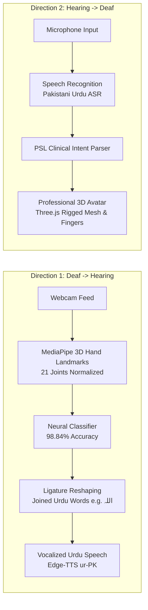

# IsharaLink (اشارہ لنک)
### Bidirectional Pakistan Sign Language (PSL) Interpretation & 3D Avatar Communication System

[](https://www.python.org/)
[](https://tensorflow.org/)
[](https://mediapipe.dev/)
[](https://threejs.org/)
[]()

---

## 📌 1. Project Overview
Over one million deaf and speech-impaired citizens in Pakistan depend on **Pakistan Sign Language (PSL)** for daily communication. **IsharaLink** bridges the communication divide between deaf individuals and hearing professionals (hospitals, banks, public counters) through an intelligent, bidirectional assistive system:

1. **Deaf $\rightarrow$ Hearing**: Real-time camera hand-landmark extraction using MediaPipe Holistic/Hands $\rightarrow$ 98.84% accurate neural sequence classifier $\rightarrow$ Ligature-joined Urdu text $\rightarrow$ Fluent vocalized Pakistani Urdu speech via Microsoft Edge Neural TTS.
2. **Hearing $\rightarrow$ Deaf**: Spoken Urdu captured via speech recognition $\rightarrow$ Clinical intent and gloss parser $\rightarrow$ Real-time interactive 3D Doctor Avatar demonstrating corresponding PSL signs in 3D WebGL space.

---

## 🏗️ 2. System Architecture



---

## ✨ 3. Key Features

- **98.84% Landmark Recognition**: Immune to background, lighting, skin tone, and distance changes.
- **Urdu Ligature Sentence Builder**: Letters dynamically combine into natural Urdu words (e.g. `ا` + `ل` + `ل` + `ہ` $\rightarrow$ `اللہ`).
- **Pakistani Urdu Voice Vocalization**: Plays natural audio (`ur-PK-UzmaNeural`) on demand.
- **Studio 3D Doctor Avatar**: Complete humanoid avatar with clinical coat, stethoscope, head facial features, and **5 individual articulable fingers (Thumb, Index, Middle, Ring, Pinky)**.
- **🏥 Hospital & Emergency Counter Mode**: Clinical dialogue presets for doctor-patient interactions (Fever, Blood Pressure, Medicine, Pain, Wait).
- **Dual Fullscreen Mode**: High-definition camera display with zero edge-cropping.
- **Offline TFLite Model**: Lightweight 77 KB edge model for zero-latency execution.

---

## 📂 4. Project Structure

```text
IsharaLink/
│
├── class_labels.json                 # 37 Pakistan Sign Language classes
├── landmarks_dataset.npz             # 1,640 verified landmark samples
├── isharalink_landmarks_model.keras  # Trained 98.84% neural network
├── isharalink_landmarks_model.tflite # 77 KB ultra-lightweight offline model
│
├── record_landmarks.py               # Interactive dataset recorder
├── train_landmarks.py                # 5-second neural network trainer
├── urdu_tts.py                       # Microsoft Edge Pakistani Urdu speech engine
├── isharalink_live_translator.py     # Standalone desktop OpenCV translator
├── run_app.py                        # Web dashboard launcher
│
├── web_app/                          # Full-Stack Web Platform
│   ├── app.py                        # Flask server & high-speed video stream
│   └── templates/
│       └── index.html                # Responsive Dual-Screen WebGL Dashboard
│
├── requirements.txt                  # Python dependencies
├── .gitignore                        # Git configuration
└── README.md                         # Documentation
```

---

## 🚀 5. Installation & Quick Start

### 1. Clone the Repository
```bash
git clone https://github.com/YOUR_USERNAME/IsharaLink.git
cd IsharaLink
```

### 2. Set Up Virtual Environment & Dependencies
```bash
python -m venv venv
.\venv\Scripts\activate
pip install -r requirements.txt
```

### 3. Launch Web Application
```bash
python run_app.py
```
Open your browser at: **`http://localhost:5000`**

---

## 🎮 6. Interactive Controls
- **Deaf Side**:
  - Show hand in front of camera $\rightarrow$ Live sign & confidence displayed.
  - Click `➕ Add Letter` or press `[SPACE]` to append letter to word.
  - Click `⛶ Fullscreen` to expand the camera stream.
  - Click `🔊 Vocalize in Fluent Urdu` to speak the word out loud.
- **Hearing Side**:
  - Click `🎙️ Press to Speak Urdu` and speak into your microphone.
  - Click any clinical chip (`نام کیا ہے؟`, `کہاں درد ہے؟`, `بخار`, `دوائی`, `بلڈ پریشر`) to watch the 3D Avatar demonstrate the signs.
  - Drag mouse on 3D avatar to rotate 360° and scroll to zoom.

---

## 📜 7. License & Credits
Developed as a **Final Year Project (FYP)** for assistive communication in Pakistan.
Designed for hospitals, banks, educational institutions, and public service counters.
